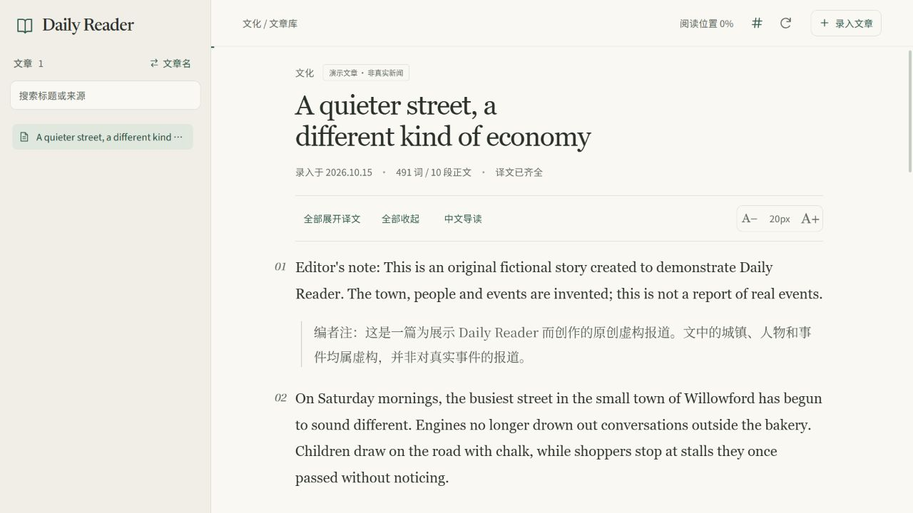

# Daily Reader

An English news reader with paragraph-by-paragraph Chinese translations, reading guides, and AI-assisted article import via MCP.

Daily Reader 是一个简约的本地英语新闻阅读工具。保存新闻原文，点击段落即可展开对应中文译文，也可切换到中文导读。支持文章归档、阅读位置恢复、键盘快捷键，以及通过 MCP 和 Skill 辅助录入、翻译与生成导读。



## 阅读体验

- 点击英文段落，在下方平滑展开或收起对应译文；支持全部展开、全部收起。
- 点击“中文导读”，阅读独立整理的中文主线、背景与概念说明。
- **→** 进入导读，**←** 返回原文；编辑输入框时不触发快捷键。
- 点击顶栏 **#** 图标，显示或隐藏段前编号。
- 左侧单行文章列表，长标题自动省略；可以切换为载入日期显示。
- 自动保存阅读位置、字号、展开状态与编号偏好。
- 窄屏文章库抽屉、键盘焦点、减少动画偏好与轻量状态提示。

暖纸色界面，Newsreader 英文刊头，思源宋体中文译文。字体随项目提供，页面不依赖在线字体服务。

## 快速开始

需要 **Python 3.10+**。普通网页阅读只使用 Python 标准库，无需 Node、构建步骤或翻译 API Key。

```sh
git clone https://github.com/yanjunlin828-dotcom/daily-reader.git
cd daily-reader
python -B server.py
```

浏览器打开 **http://127.0.0.1:8765**，保持服务运行，按 `Ctrl+C` 停止。

Windows 也可以双击 `启动阅读库.cmd`。`open_reader.pyw` 提供后台启动并打开浏览器的入口，可在自己的电脑上为它创建快捷方式，并使用 `icons/reader.ico` 作为图标。

端口被占用时，使用 `python -B server.py --port 8766` 并访问对应端口。服务仅监听本机回环地址，不会自动开放到公网。

## 内置原创示例

启动后可直接阅读 **A quieter street, a different kind of economy**：一篇关于周末步行街试验的原创虚构报道，包含完整逐段译文、中文导读、小标题和列表。

城镇、人物和事件均为虚构，文章已标注“演示文章 · 非真实新闻”；不包含第三方新闻全文，也不冒用新闻机构来源。示例展示了如何对照英文阅读，以及如何在导读中理解不同立场、因果关系和不确定性。


示例原文与译文位于 [demo-slower-saturday.json](data/articles/demo-slower-saturday.json)，导读文本可直接阅读 [中文导读示例](docs/examples/demo-reading-guide.md)。

## 录入自己的文章

点击“录入文章”，填写标题并粘贴正文，预览分段后保存。支持：

- 普通英文：默认按空行分段，普通换行保留在同一段中。
- 双语标记：参考 [bilingual.txt](docs/examples/bilingual.txt)，同一编号绑定原文与译文。
- 完整文章 JSON：参考 [article.json](docs/examples/article.json) 与 [数据约定](docs/data-contract.md)。

可以在预览中调整类型、拆分或合并尚无译文的内容块。译文可以手动填写，也可以在 AI 对话中通过 MCP 和 Skill 生成；网页展示的是已保存的翻译结果，不在阅读时调用翻译模型。

文章按原文查重，补译只填空缺并保留历史版本。中文导读独立保存，不覆盖文章或已有不同导读。

## MCP 与 Skill

AI 接入是可选功能。使用它时安装 `requirements-mcp.txt`，并参照 [MCP 配置说明](docs/mcp-setup.md) 设置解释器和实际仓库路径。

项目提供文章准备、保存、查询、读取、补译，以及中文导读准备、保存和读取，共八个本地 STDIO MCP 工具。配套 Skill 位于 [skills/english-news-ingest](skills/english-news-ingest)。

可以向已配置好的 AI 对话发送：

> 使用 $english-news-ingest，把这篇新闻录入 Daily Reader，保持原文分段，逐段翻译并核对后保存，再添加中文导读。完成后回读检查。

保存需要当前用户授权。只想预览时说明“先预览，不保存”。项目不会自动修改用户级 MCP 配置、定时选新闻或向外部服务上传文章。

## 数据与隐私

```text
data/
  folders.json                   文件夹元数据
  articles/demo-slower-saturday.json
  guides/demo-slower-saturday/    内置示例的中文导读
  records/                       运行后新增的文章及补译版本
```

个人文章、历史快照、导读、备份、日志和本机配置默认被 `.gitignore` 排除；只有明确列出的原创示例数据进入版本控制。自己的数据会保留在电脑上，不会因添加文章而自动上传 GitHub。

阅读位置、字号等偏好保存在当前浏览器、当前访问地址的 `localStorage` 中；未保存草稿在当前标签页的 `sessionStorage` 中。更换浏览器或端口后，阅读记录不共享，文章文件仍在本地。

备份与恢复见 [说明](docs/backup-and-restore.md)。备份包括文章、原始输入、历史版本和导读；不包含浏览器阅读偏好。

## 项目结构

| 路径 | 用途 |
| --- | --- |
| `server.py` | 本地 HTTP 服务与网页接口 |
| `storage.py`、`importer.py` | 校验、分段、不可变文章版本 |
| `reading_guide.py` | 独立中文导读存储 |
| `mcp_server.py`、`library_cli.py` | MCP 服务及备用客户端 |
| `web/` | 原生 HTML、CSS、JavaScript 与本地字体 |
| `skills/` | AI 录入、翻译与导读流程 |
| `tests/` | 使用隔离目录的功能检查 |

## 检查

不要求运行测试才能阅读。需要开发验证时，在仓库根目录执行：

```sh
python -B -X utf8 tests/test_stage34.py
python -B -X utf8 tests/test_refinement.py
python -B -X utf8 tests/test_launcher.py
```

安装可选 MCP 依赖后可执行：

```sh
python -B -X utf8 tests/test_mcp.py
python -B -X utf8 tests/test_stage56.py
```

动画状态检查可使用 `node tests/test_motion.cjs`。测试只在项目的 `output/` 下创建独立数据，部分检查使用本机随机端口；不会改写示例文章或访问真实新闻服务。

## 字体与示例内容

字体保留原文件和 SIL Open Font License，来源、许可证及校验记录见 [THIRD_PARTY.md](docs/THIRD_PARTY.md)。

GitHub 保存的是项目源码；应用需要 Python 后端在本机运行，不能直接作为纯静态 GitHub Pages 网站运行。
